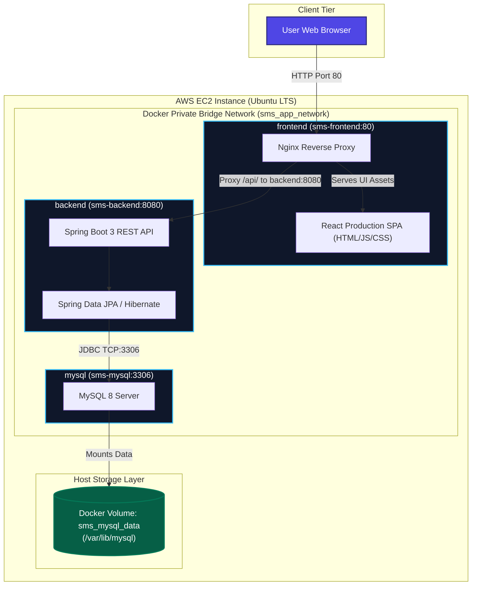

# Student Management System

> **AWS DevOps Credit Completion Project**  
> A Production-Ready Multi-Container Full-Stack Web Application built with **React (Vite)**, **Java Spring Boot 3**, **MySQL 8**, **Docker Compose**, and deployed on **AWS EC2**.

---

## 1. Abstract & Project Objective

The **Student Management System (SMS)** is an enterprise-grade web application designed to fulfill the requirements of the AWS DevOps course credit completion. It provides complete lifecycle management for academic student records—allowing administrators and faculty to create, read, search, update, and delete student data in real-time.

### Primary Objectives:
- Implement a modern, responsive Single Page Application (SPA) using React and Vite with clean design principles.
- Build a robust, scalable RESTful API using Java Spring Boot 3 with layered enterprise architecture (Controller-Service-Repository).
- Ensure data integrity, validation, and relational persistence via MySQL with Docker volume persistence.
- Containerize all tiers using multi-stage Docker builds and orchestrate them via Docker Compose on an isolated private bridge network.
- Deploy the containerized application on an AWS EC2 Ubuntu instance following strict cloud security and networking best practices.

---

## 2. Problem Statement

Educational institutions frequently suffer from fragmented student data management, where student records are kept across disparate spreadsheets or unintegrated databases. This leads to:
- Duplicate student registrations and conflicting email records.
- Poor searchability and slow query response times.
- Lack of centralized validation and security.
- Deployment fragility due to environmental discrepancies between development and production environments ("it works on my machine" syndrome).

This project resolves these challenges by introducing a centralized, containerized, and cloud-deployable full-stack solution with enforced database constraints and automated multi-container orchestration.

---

## 3. Technology Stack & Version Specifications

| Tier / Component | Technology | Version | Purpose / Role |
| :--- | :--- | :--- | :--- |
| **Frontend SPA** | React | `^18.3.1` | Modern user interface & dynamic state management |
| **Frontend Tooling** | Vite | `^5.4.2` | Rapid build tool, HMR dev server & asset bundler |
| **Web Server / Proxy**| Nginx | `1.27-alpine` | Reverse proxy `/api` traffic & serve static assets |
| **Backend Framework** | Spring Boot | `3.3.4` | Enterprise RESTful API, dependency injection & routing |
| **Programming Language** | Java (JDK/JRE) | `17 / 21 LTS` | Robust object-oriented backend execution |
| **Build Automation** | Apache Maven | `3.9.6` | Dependency management and build packaging |
| **Persistence / ORM** | Spring Data JPA / Hibernate | `6.5.3` | Relational data mapping and query execution |
| **Database** | MySQL | `8.0` | Relational SQL storage engine |
| **Container Engine** | Docker | `24+ / 27+` | Isolated application containers |
| **Orchestration** | Docker Compose | `v2.20+` | Multi-container networking & volume mounting |
| **Cloud Infrastructure**| AWS EC2 | Ubuntu 22.04/24.04 LTS | Cloud hosting virtual machine |

---

## 4. System Architecture

The application adopts a 3-tier micro-service container architecture. The user's browser interacts exclusively with the public HTTP port (`80`) exposed by Nginx. All backend API calls are transparently proxied to the Spring Boot container over an isolated internal Docker bridge network, ensuring that neither the backend port (`8080`) nor the database port (`3306`) are exposed to the public internet.

### Architecture Flow

```
User Browser
    │
    ▼
Nginx + React Frontend Container (Port 80)
    │
    │ /api requests (Internal Proxy)
    ▼
Spring Boot Backend Container (Port 8080)
    │
    ▼
MySQL Database Container (Port 3306 Internal)
    │
    ▼
Persistent Named Docker Volume (sms_mysql_data)
```

### Mermaid Architecture Diagram



---

## 5. Project Directory Structure

```
student-management-system/
├── frontend/
│   ├── public/                      # Static web assets & icons
│   ├── src/
│   │   ├── components/
│   │   │   ├── DeleteConfirmModal.jsx # Deletion safety modal
│   │   │   ├── NotificationToast.jsx  # Auto-dismiss notifications
│   │   │   ├── StudentHeader.jsx      # Title, health status & actions
│   │   │   ├── StudentModal.jsx       # Add/Edit form with validation
│   │   │   ├── StudentStats.jsx       # Metric counters & KPI cards
│   │   │   └── StudentTable.jsx       # Data grid & search controls
│   │   ├── services/
│   │   │   └── studentService.js    # API client with error mapping
│   │   ├── App.jsx                  # Master React controller state
│   │   ├── index.css                # Custom modern design tokens
│   │   └── main.jsx                 # React root mounting
│   ├── Dockerfile                   # Multi-stage Node + Nginx build
│   ├── index.html                   # HTML template with SEO tags
│   ├── nginx.conf                   # Reverse proxy & SPA routing config
│   ├── package.json                 # Node dependencies & build scripts
│   └── vite.config.js               # Vite bundler & dev proxy config
├── backend/
│   ├── src/
│   │   ├── main/
│   │   │   ├── java/com/sms/
│   │   │   │   ├── config/
│   │   │   │   │   └── WebConfig.java             # CORS configuration
│   │   │   │   ├── controller/
│   │   │   │   │   ├── HealthController.java      # GET /api/health
│   │   │   │   │   └── StudentController.java     # Student CRUD endpoints
│   │   │   │   ├── entity/
│   │   │   │   │   └── Student.java               # JPA Entity with constraints
│   │   │   │   ├── exception/
│   │   │   │   │   ├── DuplicateResourceException.java
│   │   │   │   │   ├── ErrorResponse.java
│   │   │   │   │   ├── GlobalExceptionHandler.java
│   │   │   │   │   └── ResourceNotFoundException.java
│   │   │   │   ├── repository/
│   │   │   │   │   └── StudentRepository.java     # JPA multi-field search
│   │   │   │   ├── service/
│   │   │   │   │   ├── impl/
│   │   │   │   │   │   └── StudentServiceImpl.java
│   │   │   │   │   └── StudentService.java
│   │   │   │   └── StudentManagementApplication.java
│   │   │   └── resources/
│   │   │       └── application.properties         # Config with env variables
│   │   └── test/
│   │       ├── java/com/sms/
│   │       │   ├── StudentControllerTest.java     # MockMvc REST tests
│   │       │   ├── StudentRepositoryTest.java     # DataJpaTest persistence
│   │       │   └── StudentServiceTest.java        # Unit tests with Mockito
│   │       └── resources/
│   │           └── application.properties         # In-memory H2 config
│   ├── Dockerfile                   # Multi-stage Maven + Temurin JRE build
│   └── pom.xml                      # Maven dependencies & plugins
├── backup-restore.sh                # MySQL backup & restore utility
├── deploy-ec2.sh                    # Automated AWS EC2 setup & deploy script
├── docker-compose.yml               # Multi-container orchestration definition
├── .env.example                     # Sample template for environment vars
├── .env                             # Local active configuration (gitignored)
├── .gitignore                       # Ignored build artifacts and secrets
└── README.md                        # Complete project documentation
```

---

## 6. Prerequisites

To build and run the project locally or in the cloud, ensure the following are installed:

- **Git** (for version control and transferring files)
- **Docker Engine** (v24.0+ recommended)
- **Docker Compose** (v2.20+ recommended)
- *Optional for local non-Docker development:*
  - **Node.js** (v18+ or v20+) and **npm**
  - **Java Development Kit (JDK 17 or 21 LTS)**
  - **Apache Maven 3.9+**

---

## 7. Environment Variable Configuration

The project reads all database connection parameters from environment variables. An example file `.env.example` is provided:

```bash
# MySQL Container Initialization
MYSQL_DATABASE=student_db
MYSQL_USER=student_user
MYSQL_PASSWORD=change_this_student_db_password
MYSQL_ROOT_PASSWORD=change_this_root_secure_password

# Spring Boot Database Connection
DB_HOST=mysql
DB_PORT=3306
DB_NAME=student_db
DB_USERNAME=student_user
DB_PASSWORD=change_this_student_db_password

# Application Settings
CORS_ALLOWED_ORIGINS=*
PORT=80
```

> [!IMPORTANT]
> The `.env` file contains sensitive credentials and is strictly excluded from version control via `.gitignore`. Never commit `.env` or plain-text passwords to any repository.

---

## 8. Backend API Documentation

All backend endpoints are prefixed with `/api`.

| HTTP Method | Endpoint | Description | Request Body | Success Code | Error Codes |
| :--- | :--- | :--- | :--- | :--- | :--- |
| **GET** | `/api/students` | Retrieve all students | None | `200 OK` | `500` |
| **GET** | `/api/students?search={kw}` | Search students by keyword | None | `200 OK` | `500` |
| **GET** | `/api/students/{id}` | Retrieve single student by ID | None | `200 OK` | `404` |
| **GET** | `/api/students/count` | Total student count | None | `200 OK` | `500` |
| **POST** | `/api/students` | Create a new student record | Student JSON | `201 Created` | `400`, `409` |
| **PUT** | `/api/students/{id}` | Update existing student record| Student JSON | `200 OK` | `400`, `404`, `409` |
| **DELETE**| `/api/students/{id}` | Delete a student record | None | `200 OK` | `404` |
| **GET** | `/api/health` | Application & DB health status | None | `200 OK` | `500` |

### Sample JSON Request Payload (`POST /api/students`):

```json
{
  "studentId": "STU-2024-001",
  "firstName": "Alex",
  "lastName": "Morgan",
  "email": "alex.morgan@university.edu",
  "department": "Computer Science",
  "course": "Cloud DevOps Engineering",
  "phone": "+1-555-0199"
}
```

### Sample Health Check Response (`GET /api/health`):

```json
{
  "status": "UP",
  "service": "Student Management System Backend",
  "database": "CONNECTED",
  "version": "1.0.0",
  "timestamp": "2026-10-24T10:45:00"
}
```

---

## 9. Dockerfile Explanations

### Frontend Dockerfile (`frontend/Dockerfile`)
The frontend uses a **multi-stage build** to optimize security and minimize container image size:
1. **Builder Stage (`node:20-alpine`)**: Installs dependencies and bundles React source into static HTML, JavaScript, and CSS assets via `npm run build`.
2. **Runtime Stage (`nginx:1.27-alpine`)**: Discards all Node.js runtimes, package managers, and development dependencies. It copies solely the compiled `dist/` directory and custom `nginx.conf` into an ultra-compact Alpine Nginx image (~25MB), drastically reducing attack surface and startup time.

### Backend Dockerfile (`backend/Dockerfile`)
The backend also uses a **multi-stage build**:
1. **Builder Stage (`maven:3.9.6-eclipse-temurin-17-alpine`)**: Leverages Docker layer caching for Maven dependencies (`mvn dependency:go-offline`) and packages the Spring Boot application JAR.
2. **Runtime Stage (`eclipse-temurin:17-jre-alpine`)**: Uses a minimal Java Runtime Environment. Creates an unprivileged non-root user (`spring:spring`), installs `curl` for container health checks, and executes `java -jar app.jar`.

---

## 10. Docker Compose Orchestration

The `docker-compose.yml` coordinates the 3 services:

```yaml
version: '3.8'

services:
  mysql:
    image: mysql:8.0
    container_name: sms-mysql
    restart: unless-stopped
    environment:
      MYSQL_DATABASE: ${MYSQL_DATABASE:-student_db}
      MYSQL_USER: ${MYSQL_USER:-student_user}
      MYSQL_PASSWORD: ${MYSQL_PASSWORD:-student_pass}
      MYSQL_ROOT_PASSWORD: ${MYSQL_ROOT_PASSWORD:-root_secure_password}
    volumes:
      - mysql_data:/var/lib/mysql
    networks:
      - sms-network
    healthcheck:
      test: ["CMD-SHELL", "mysqladmin ping -h 127.0.0.1 -u root -p$${MYSQL_ROOT_PASSWORD} || exit 1"]
      interval: 10s
      timeout: 5s
      retries: 5
      start_period: 30s

  backend:
    build:
      context: ./backend
      dockerfile: Dockerfile
    container_name: sms-backend
    restart: unless-stopped
    environment:
      DB_HOST: mysql
      DB_PORT: 3306
      DB_NAME: ${DB_NAME:-student_db}
      DB_USERNAME: ${DB_USERNAME:-student_user}
      DB_PASSWORD: ${DB_PASSWORD:-student_pass}
      CORS_ALLOWED_ORIGINS: "*"
    depends_on:
      mysql:
        condition: service_healthy
    networks:
      - sms-network

  frontend:
    build:
      context: ./frontend
      dockerfile: Dockerfile
    container_name: sms-frontend
    restart: unless-stopped
    ports:
      - "80:80"
    depends_on:
      - backend
    networks:
      - sms-network

volumes:
  mysql_data:
    name: sms_mysql_data
    driver: local

networks:
  sms-network:
    name: sms_app_network
    driver: bridge
```

### Key Orchestration Features:
- **Dependency Ordering**: `backend` waits for `mysql` to achieve **`service_healthy`** state before starting, eliminating race conditions and database connection refused errors during boot.
- **Port Isolation**: Only port `80:80` is published to the host. Neither `3306` nor `8080` are exposed externally.
- **Persistent Storage**: Named volume `sms_mysql_data` guarantees student records survive container restarts and updates.

---

## 11. Commands Guide

### Start the Application (Build and Run in Background)
```bash
docker compose up --build -d
```

### Stop the Application (Preserving Database Data)
```bash
docker compose down
```

> [!CAUTION]
> Do NOT use `docker compose down -v` during standard shutdowns because the `-v` flag removes named Docker volumes and will permanently erase the database.

### Check Container Status
```bash
docker compose ps
```

### Inspect Container Logs
```bash
# View logs from all services in real time
docker compose logs -f

# View logs for a specific service
docker compose logs -f backend
docker compose logs -f frontend
docker compose logs -f mysql
```

### Restart a Specific Container
```bash
docker compose restart backend
```

---

## 12. Database Persistence & Backup Procedures

### Persistence Verification:
1. Add a student record via the frontend or API.
2. Run `docker compose down`.
3. Restart the containers with `docker compose up -d`.
4. Refresh the web page—the student records remain fully preserved from the `sms_mysql_data` volume.

### Creating a Database Backup:
Using the included utility script:
```bash
chmod +x backup-restore.sh
./backup-restore.sh backup
```
Or manually via Docker:
```bash
docker exec -e MYSQL_PWD=root_secure_password sms-mysql \
  mysqldump -u root --single-transaction student_db > backup_student_db.sql
```

### Restoring a Database Backup:
Using the included utility script:
```bash
./backup-restore.sh restore backups/student_db_backup_xxxx.sql
```
Or manually via Docker:
```bash
docker exec -i -e MYSQL_PWD=root_secure_password sms-mysql \
  mysql -u root student_db < backup_student_db.sql
```

---

## 13. AWS EC2 Deployment Walkthrough

### Step 1: Sign in to AWS Console & Launch EC2 Instance
1. Log in to the [AWS Management Console](https://aws.amazon.com/console/).
2. Navigate to the **EC2 Dashboard** and click **Launch Instance**.
3. **Name**: `student-management-system-ec2`.
4. **AMI**: Select **Ubuntu Server 22.04 LTS** (or 24.04 LTS), 64-bit (x86_64).
5. **Instance Type**: Select **`t2.small`** or **`t3.small`** (2 vCPU, 2 GiB RAM) to ensure adequate memory for running Spring Boot (JVM), MySQL 8, and Nginx concurrently without memory pressure. (A `t2.micro` with 1GB RAM can experience OOM unless a 2GB Linux swap space is configured).
6. **Key Pair**: Choose an existing SSH key pair or create a new one (e.g., `sms-key.pem`) and download it to your local machine.

### Step 2: Configure EC2 Security Group
Configure inbound rules following the principle of least privilege:

| Type | Port Range | Protocol | Source | Purpose |
| :--- | :--- | :--- | :--- | :--- |
| **SSH** | `22` | TCP | `My IP` (e.g., `203.0.113.25/32`) | Secure server administration |
| **HTTP** | `80` | TCP | `0.0.0.0/0` (Anywhere) | Public web application access |
| **HTTPS** | `443` | TCP | `0.0.0.0/0` (Anywhere) | Secure web traffic (if SSL configured) |

> [!WARNING]
> Ensure ports `3306` (MySQL) and `8080` (Backend) are **NOT** added to inbound rules.

### Step 3: Connect via SSH
From your local terminal:
```bash
chmod 400 sms-key.pem
ssh -i "sms-key.pem" ubuntu@<YOUR-EC2-PUBLIC-IP>
```

### Step 4: Deploy the Application
#### Option A: One-Click Automated Deployment
```bash
# Clone the repository or transfer the project files
git clone <YOUR_GIT_REPO_URL> student-management-system
cd student-management-system

# Make deployment script executable and run
chmod +x deploy-ec2.sh
./deploy-ec2.sh
```

#### Option B: Manual Step-by-Step Deployment
```bash
# 1. Update Ubuntu
sudo apt-get update -y && sudo apt-get upgrade -y

# 2. Install Docker & Compose plugin
sudo apt-get install -y ca-certificates curl gnupg lsb-release
sudo install -m 0755 -d /etc/apt/keyrings
curl -fsSL https://download.docker.com/linux/ubuntu/gpg | sudo gpg --dearmor -o /etc/apt/keyrings/docker.gpg
sudo chmod a+r /etc/apt/keyrings/docker.gpg

echo "deb [arch=$(dpkg --print-architecture) signed-by=/etc/apt/keyrings/docker.gpg] https://download.docker.com/linux/ubuntu $(lsb_release -cs) stable" | sudo tee /etc/apt/sources.list.d/docker.list > /dev/null

sudo apt-get update -y
sudo apt-get install -y docker-ce docker-ce-cli containerd.io docker-compose-plugin

# 3. Add ubuntu user to docker group
sudo usermod -aG docker ubuntu
newgrp docker

# 4. Prepare production environment file
cp .env.example .env
nano .env  # set secure passwords

# 5. Launch containers
docker compose up --build -d

# 6. Verify health
docker compose ps
curl http://localhost/api/health
```

### Step 5: Access the Running System
Open your web browser and navigate to:
```
http://<YOUR-EC2-PUBLIC-IP>
```

---

## 14. Cloud Security Considerations

1. **Non-Root Execution**: Backend runs as unprivileged user `spring:spring` inside Alpine Linux.
2. **No Public DB Exposure**: MySQL port 3306 is bound exclusively to the internal Docker bridge network (`sms_app_network`).
3. **Secret Hygiene**: All database credentials are kept out of source code and Docker images, loaded strictly via runtime environment variables.
4. **Input Sanitization & Server-side Validation**: Spring Boot annotations (`@NotBlank`, `@Email`, `@Size`, `@Pattern`) validate all incoming requests.
5. **Future TLS / HTTPS Termination**: For production domain deployment, configure AWS Certificate Manager (ACM) with an Application Load Balancer (ALB) or install Certbot/Let's Encrypt with Nginx.

---

## 15. Troubleshooting & FAQ

| Issue / Symptom | Possible Cause | Resolution |
| :--- | :--- | :--- |
| `backend` exits with exit code 1 on startup | MySQL is still initializing | Check `depends_on: condition: service_healthy`. Wait for MySQL healthcheck to pass. |
| Browser shows `Connecting to API...` | Backend container is booting | Spring Boot takes ~25s to initialize Hibernate and schema. Refresh page after 30s. |
| EC2 instance runs out of memory (`Killed`) | Instance type too small (e.g., 1GB `t2.micro`) | Add 2GB swap space: `sudo fallocate -l 2G /swapfile && sudo chmod 600 /swapfile && sudo mkswap /swapfile && sudo swapon /swapfile` |
| `Permission denied` on Docker commands | User not in `docker` group | Run `sudo usermod -aG docker $USER && newgrp docker` |
| `DuplicateResourceException` HTTP 409 | Student ID or Email already exists | Ensure Student Registration Number and Email are unique across all student records. |

---

## 16. Teardown & Resource Cleanup

To avoid unnecessary AWS cloud credit usage after your project demonstration:
1. In your EC2 terminal:
   ```bash
   docker compose down -v
   ```
2. In the AWS Management Console:
   - Navigate to **EC2 > Instances**.
   - Select `student-management-system-ec2`.
   - Click **Instance State > Terminate Instance**.
3. Under **Network & Security > Key Pairs** and **Security Groups**, remove unused items.

---

## 17. Spring Boot 4 Migration — CI/CD Test Pipeline

An isolated CI/CD pipeline validates the Spring Boot 4 migration without
replacing the existing production Student Management System.

### Pipeline stages

1. Checkout the migration branch from GitHub.
2. Verify Jenkins Docker access.
3. Run backend Maven unit tests.
4. Install frontend dependencies and build the React application.
5. Build backend and frontend Docker images.
6. Scan images using Trivy for HIGH and CRITICAL vulnerabilities.
7. Publish versioned images to Docker Hub.
8. Deploy the images to the isolated Kubernetes namespace `sms-boot4-test`.
9. Verify Kubernetes rollout status.

### Tools

- Jenkins
- GitHub
- Java 17 and Maven
- React and Vite
- Docker and Docker Hub
- Trivy
- Kubernetes (K3s)

### Docker Hub images

- Backend: https://hub.docker.com/r/bunny2288h/student-management-system-backend
- Frontend: https://hub.docker.com/r/bunny2288h/student-management-system-frontend

### Isolation and safety

The migration pipeline deploys only to the `sms-boot4-test` namespace.
The existing `sms` namespace, Docker Compose deployment, and original
MySQL data are kept separate and are not modified by this pipeline.

The pipeline uses commit-based image tags so each build can be identified
and traced to its Git revision.
